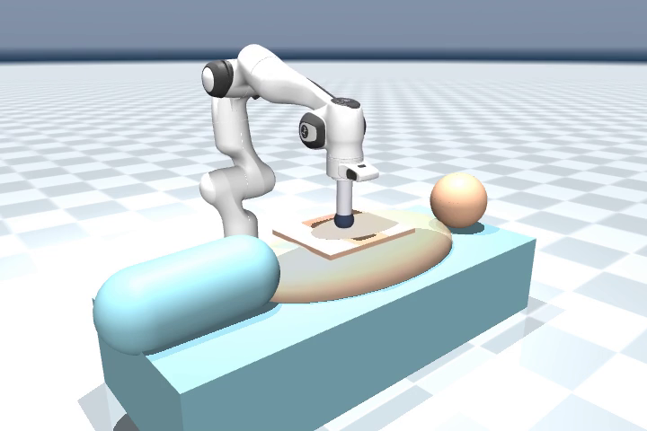
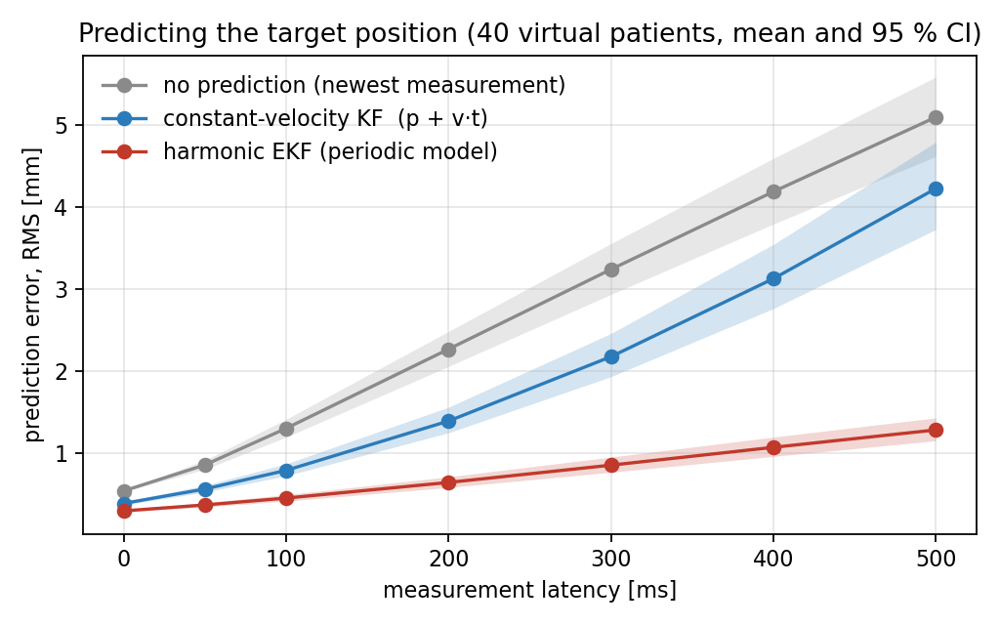
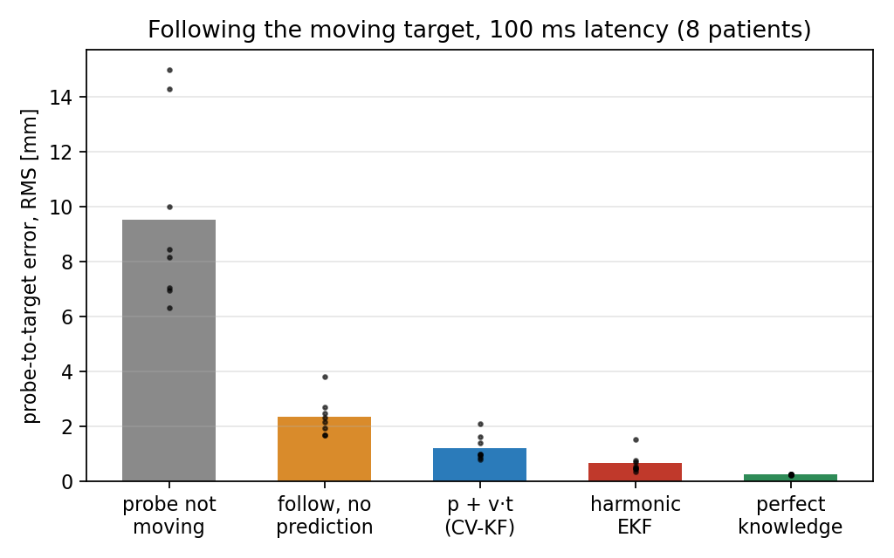
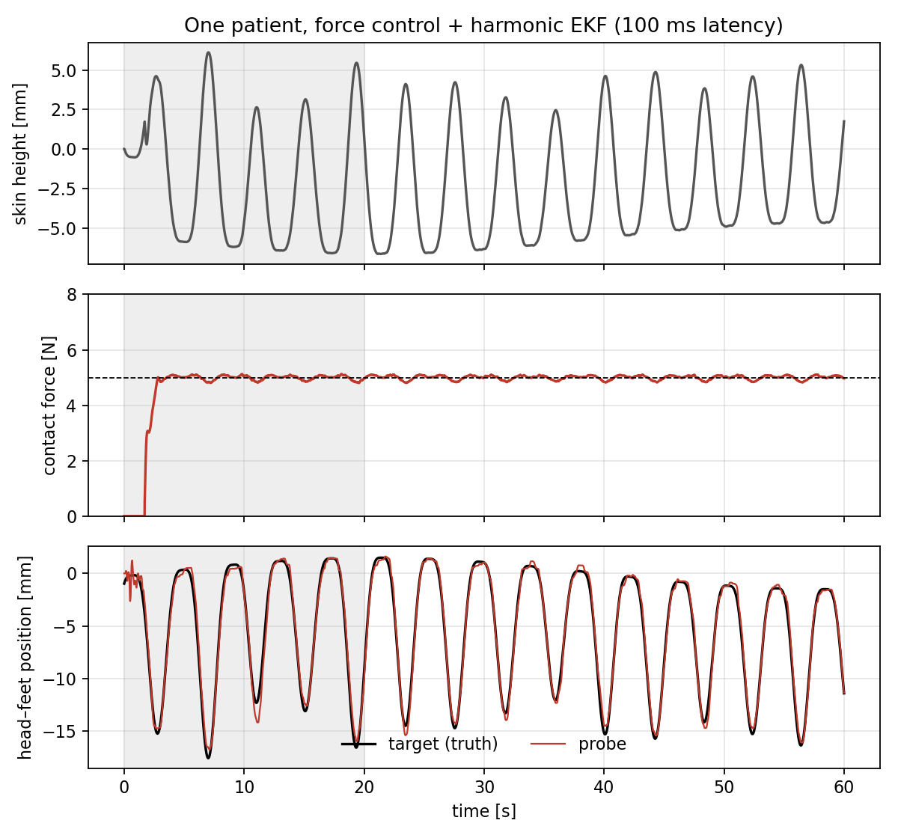
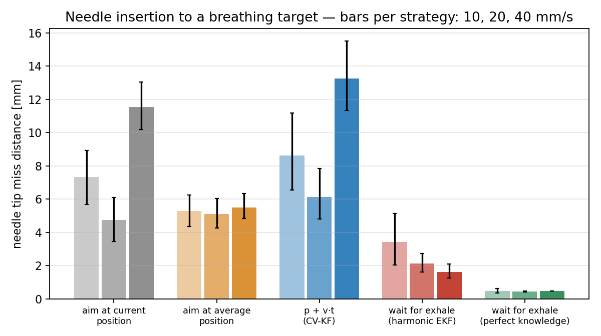

# Breathing-compensated robotic ultrasound and needle insertion with a Franka Panda (MuJoCo)

**Part 1.** A 7-DoF Franka holds an ultrasound probe on the abdomen of a breathing patient and must

1. **keep a constant contact force** (5 N) while the abdomen rises and falls, and
2. **follow an organ that moves with breathing**, using position measurements that arrive
   late (100 ms) and noisy — as they would from an ultrasound image tracker.

**Part 2.** The same robot inserts a needle to hit that moving organ target through a fixed
skin entry point, choosing where to aim and when to start.

**Research question.** To cancel the measurement delay, is straight-line prediction
(`p + v·t`, the predictor used for a rolling ball in dynamic grasping) enough, or does a
periodic breathing model (an extended Kalman filter that learns the breathing rhythm) do better?



Simulation only. No real robot, no real patient data, no ultrasound images (see *Limits*).

## Why this problem

- Breathing moves the skin by about 1 cm and abdominal organs by 1–2 cm, 12–20 times a minute.
  A probe held still loses the organ; a probe pressed with a fixed position changes its force.
- Motion compensation by prediction is a classic medical-robotics topic, and one with history at
  ICube Strasbourg (Ginhoux, Gangloff, de Mathelin et al., IEEE T-RO 2005: breathing and heartbeat
  treated as periodic disturbances and cancelled with predictive control).
- It reuses the dynamic-grasping skill set — predicting a moving target and meeting it — on a
  medical task where the target is periodic instead of ballistic.

Sources and the status of every number (verified / unverified / assumed): `docs/research_notes.md`.

## How it works

| Part | File | What it does |
|---|---|---|
| Scene | `assets/franka_emika_panda/breathing_us_scene.xml` | Franka (torque motors) + probe + force sensor; torso on a "breath" joint; skin plate on a spring–damper (soft tissue) |
| Breathing | `src/breathus/breathing.py` | `cos^(2n)` breathing curve with breath-to-breath variation and drift; drives skin height and organ position |
| Predictors | `src/breathus/estimators.py` | constant-velocity Kalman filter; harmonic EKF (offset + 2 harmonics + frequency); delayed noisy sensor |
| Needle insertion | `src/breathus/needle.py` (scene `needle_scene.xml`) | five aim/timing strategies, straight-line insertion, simple needle–tissue forces |
| Controller + simulation | `src/breathus/sim.py` | 1 kHz task-space torque control: force PI along the probe axis, position tracking sideways, fixed orientation, null-space posture |

Control axes: **z** (probe axis) = force; **y** (head–feet) = follow the organ; **x** and
orientation = hold.

## Run it

```bash
python3 tests/test_basics.py                    # 4 sanity checks, ~30 s
python3 experiments/demo.py view                # watch it live in the MuJoCo viewer
python3 experiments/demo.py                     # one episode -> outputs/demo_log.npz
python3 experiments/demo.py video               # -> outputs/demo.mp4
python3 experiments/offline_prediction.py tune  # predictor tuning (tuning patients only)
python3 experiments/offline_prediction.py sweep # prediction error vs latency, 40 test patients
python3 experiments/closed_loop.py 8 2          # robot in the loop: 8 patients, 2 workers
python3 experiments/make_figures.py             # figures + outputs/results_table.md
python3 experiments/needle_demo.py ekf          # needle video -> outputs/needle_demo_ekf.mp4
python3 experiments/needle_study.py 16 3 2      # 16 patients x 3 trials x 5 strategies x 3 speeds
python3 experiments/needle_figures.py           # outputs/needle_table.md + fig_needle.png
```

Needs `mujoco`, `numpy`, `matplotlib`, `imageio` + `imageio-ffmpeg` (video only).

## Results

### Part 1 — ultrasound probe

**A. Prediction only (no robot), 40 test patients** — RMS error of "where is the organ now?"

| Measurement delay | No prediction | `p + v·t` (CV Kalman) | Harmonic EKF |
|---|---|---|---|
| 0 ms | 0.54 mm | 0.39 mm | 0.30 mm |
| 100 ms | 1.30 mm | 0.79 mm | 0.45 mm |
| 300 ms | 3.24 mm | 2.18 mm | 0.86 mm |
| 500 ms | 5.10 mm | 4.23 mm | 1.28 mm |



**B. Robot in the loop, 8 test patients, 40 s scored each** (mean, 95 % bootstrap CI over patients)

| Organ following (force control on) | Probe-to-organ error, RMS |
|---|---|
| Probe not moving | 9.52 mm (7.55–11.90) |
| Following, no prediction | 2.34 mm (1.95–2.85) |
| `p + v·t`, 100 ms delay | 1.21 mm (0.96–1.53) |
| Harmonic EKF, 100 ms delay | 0.67 mm (0.47–0.93) |
| Perfect knowledge (robot tracking limit) | 0.25 mm (0.24–0.25) |
| `p + v·t`, 300 ms delay | 3.01 mm (2.33–3.86) |
| Harmonic EKF, 300 ms delay | 1.11 mm (0.74–1.62) |

Paired difference `p + v·t` minus EKF: 0.55 mm at 100 ms (CI 0.28–0.84, EKF better in 7 of 8
patients); 1.90 mm at 300 ms (CI 1.28–2.64, better in 8 of 8).

| Contact force (target 5 N) | Force RMSE | Highest force | Time above 7.5 N |
|---|---|---|---|
| Explicit force control (PI on the force sensor) | 0.09 N (0.07–0.12) | 5.2 N | 0 % |
| Impedance only, soft (300 N/m) | 0.98 N (0.83–1.16) | 8.5 N | 1.7 % |
| Impedance only, stiff (1500 N/m) | 2.19 N (1.81–2.65) | 12.9 N | 18.0 % |

Contact was never lost in any run. Full table: `outputs/results_table.md`.




**Reading.** The periodic model beats straight-line prediction, and the gap grows with the delay.
Explicit force control is far better than impedance alone — but see limit 4: the simulated robot
is ideal, so 0.09 N is a best case, not a hardware prediction.

### Part 2 — needle insertion to the moving target

The robot inserts a needle through one fixed skin entry point to a target 60 mm deep. Inside
tissue the needle cannot be swung sideways, so the robot only chooses **where to aim** and
**when to start** — an interception problem. 16 test patients × 3 random start moments = 48
insertions per strategy and speed. Miss distance = tip-to-target distance at arrival
(mean over patients, 95 % bootstrap CI).

| Strategy | 10 mm/s | 20 mm/s | 40 mm/s |
|---|---|---|---|
| Aim at current position, go now | 7.32 mm (5.67–8.94) | 4.74 mm (3.45–6.09) | 11.54 mm (10.19–13.06) |
| Aim at average position, go now | 5.28 mm (4.36–6.26) | 5.12 mm (4.26–6.05) | 5.50 mm (4.83–6.35) |
| `p + v·t` (limited to the seen range), go now | 8.63 mm (6.57–11.18) | 6.13 mm (4.80–7.84) | 13.26 mm (11.35–15.51) |
| **Wait for end-of-exhale, harmonic EKF** | **3.41 mm (2.03–5.14)** | **2.13 mm (1.63–2.72)** | **1.62 mm (1.25–2.12)** |
| Wait for end-of-exhale, perfect knowledge | 0.49 mm (0.35–0.64) | 0.44 mm (0.42–0.46) | 0.47 mm (0.46–0.48) |

| Harmonic EKF strategy | 10 mm/s | 20 mm/s | 40 mm/s |
|---|---|---|---|
| Insertions within 2 mm | 58 % | 65 % | 81 % |
| Worst single insertion | 17.7 mm | 11.9 mm | 5.5 mm |
| Average wait before starting | 1.4 s | 1.2 s | 1.3 s |

The sideways shift of the shaft at the entry point stayed near 1 mm or below on average for
every strategy. Full tables with paired differences: `outputs/needle_table.md`.



**Reading.**
- Timing the insertion with the breathing model cuts the miss to 1.6–3.4 mm, against 4.7–13 mm
  for the untimed strategies. The EKF strategy was better than each of them in at least 13 of 16
  patients at every speed.
- Straight-line prediction is the wrong tool here: an insertion lasts 2–8 s, as long as a whole
  breath. Without the range limit it aims outside the body (and once made the simulation blow up).
- "Aim at current position" looks good at 20 mm/s only by coincidence: the insertion then lasts
  about one breath (4 s), so the target comes back to where it was.
- The EKF is still far from the perfect-knowledge bound (0.4–0.5 mm), with rare large misses.
  The cause is timing: breathing is irregular from breath to breath, and several seconds of
  look-ahead cannot be predicted well. Retuning the filter for a 4 s horizon did not help
  (checked on the tuning patients). Faster insertion helps because the look-ahead is shorter.
- So in this model, prediction alone is not enough for a clinical-grade guarantee; it would need
  a safety rule (abort or pause if breathing departs from the prediction) or a breath-hold.

Videos: `outputs/demo.mp4` (ultrasound), `outputs/needle_demo_ekf.mp4` (needle).

## Method notes (what makes the comparison fair)

- **Separate patients for tuning and testing.** Filter settings were chosen on patients with
  seeds 100–111 (`outputs/tuning_log.txt`); all reported numbers use seeds 0–39.
- **Same tuning effort** for both predictors: a small grid each, scored by the same metric.
- **Paired comparison.** Every method sees exactly the same patient, the same breathing and the
  same sensor noise; differences are reported per patient with bootstrap 95 % confidence intervals.
- **Scoring uses ground truth** (true contact force from the physics engine, true organ
  position). The controller only sees the noisy, delayed sensors.
- The first 20 s of every episode (approach, filter warm-up) are not scored.

## Limits — read before quoting any number

1. **Synthetic breathing.** The `cos^(2n)` curve contains only a few harmonics, which is close to
   what the harmonic EKF assumes. The EKF's advantage is therefore probably optimistic. The real
   test is recorded patient breathing, which is not done here.
2. **No ultrasound image.** The "image tracker" is the true organ position + noise + delay.
3. **Simple tissue.** One spring–damper under a flat plate; no deformable body, no skin sliding.
4. **Ideal robot.** No Coulomb joint friction, torque ripple or communication delay, so force
   regulation is better than real hardware would give. For scale: a real UR3e arm alone on a
   breathing phantom at 5 N had 4.30 N RMSE (arXiv 2410.03086, Table III) — not comparable 1:1.
5. **Organ and skin move perfectly in phase**; real organs lag and show hysteresis.
6. **Needle model is very simple** (Part 2): rigid needle, no bending, the organ does not drag
   the needle, the needle does not push the target; every tissue number is an assumption.
   Only the tip position at the arrival time is scored.
7. **Small sample** in the closed-loop study, and several physical values are assumptions
   (tissue stiffness, sensor noise, latency, variability). They are listed in `docs/research_notes.md`.

## Possible next steps

- Replace synthetic breathing with recorded respiratory traces (the decisive test for limit 1).
- Add joint friction and a control delay, then test whether a predictive/repetitive force
  controller (the ICube R-GPC idea) beats the PI loop.
- Simulate the ultrasound image and close the loop by visual servoing.
- Needle: add a safety rule (pause/abort when breathing departs from the prediction) and
  step-wise insertion that advances only during the exhale rest.

## Credits

Franka Emika Panda model from MuJoCo Menagerie (see `assets/franka_emika_panda/LICENSE`), modified:
torque motors instead of position servos, probe and force sensor added.
